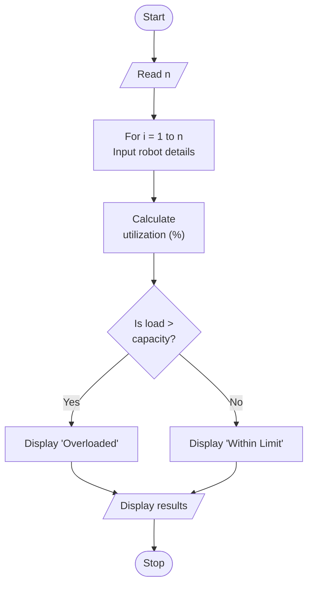

# Robot-Load-Utilization-Analysis


# Assignment 07: Robot Load Utilization Analysis using Array of Structures in C

## 1. Problem Statement

Write a C program to accept robot ID, robot type, payload capacity, actual load, and operating time for multiple robotic arms. Calculate the load utilization percentage and identify robots operating beyond their rated payload.

## 2. Objectives

- To understand the basics of structures in C programming.
- To learn how to declare and use an array of structures.
- To store the details of multiple robots using a single array.
- To accept robot ID, robot type, payload capacity, actual load, and operating time from the user.
- To calculate the load utilization percentage using the given formula.
- To use conditional statements to identify robots operating beyond their rated payload.
- To validate user input and avoid division by zero.
- To display the details of all robots in a formatted tabular form.

## 3. Theory

### What Is a Structure in C?

A structure is a user-defined data type that groups variables of different data types under a single name. Each variable declared inside a structure is called a member.

Arrays can store only elements of the same data type, whereas a structure can store an integer, a string, and floating-point values together. This makes structures suitable for representing real-world entities such as a student, an employee, or a robot.

**Syntax:**

```c
struct structure_name {
    data_type member1;
    data_type member2;
    data_type member3;
};
```

**Example:**

```c
struct Robot {
    int id;
    char type[30];
    float capacity;   // Rated payload (kg)
    float load;       // Actual load (kg)
    float time;       // Operating time (hours)
};
```

This structure stores the details of one robot. It does not occupy memory until a variable of this structure type is declared.

```c
struct Robot r1;
```

### How Are Structure Members Accessed?

The members of a structure variable are accessed using the dot operator (`.`).

```c
r1.id = 101;
r1.capacity = 20.5;
printf("%d", r1.id);
```

For a pointer to a structure, the arrow operator (`->`) is used.

```c
struct Robot *ptr = &r1;
printf("%d", ptr->id);
```

### What Is an Array of Structures?

An array of structures is a collection of structure variables of the same type stored in contiguous memory locations. It allows the program to store and process the records of multiple entities using a single array name.

**Syntax:**

```c
struct structure_name array_name[size];
```

**Example:**

```c
struct Robot r[100];
```

Here, `r` is an array that can store the details of up to 100 robots. The first robot is stored in `r[0]`, the second in `r[1]`, and so on. Members are accessed using the array index followed by the dot operator.

```c
r[0].id
r[1].capacity
r[i].load
```

### What Are the Uses of an Array of Structures?

- Storing the records of multiple students, employees, books, products, or robots.
- Handling large amounts of related data using loops.
- Sorting, searching, and processing records based on a particular member.
- Generating reports and tables from stored data.
- Implementing simple database-like programs without using files or external libraries.

### What Is the Difference Between a Structure and a Union?

| Structure | Union |
|-----------|-------|
| Declared using the `struct` keyword. | Declared using the `union` keyword. |
| Each member has its own memory location. | All members share the same memory location. |
| Size is the sum of the sizes of all members, including padding. | Size is the size of the largest member. |
| All members can hold values at the same time. | Only one member holds a valid value at a time. |

### What Is Load Utilization?

Load utilization shows how much of a robot's rated payload capacity is being used. It is calculated using the following formula:

```text
Utilization (%) = (Actual Load / Payload Capacity) x 100
```

**Examples:**

- Capacity = 20 kg, Load = 15 kg: Utilization = (15 / 20) x 100 = 75%
- Capacity = 10 kg, Load = 12 kg: Utilization = (12 / 10) x 100 = 120%

A utilization value above 100% means that the robot is operating beyond its rated payload.

### How Does the Program Identify an Overloaded Robot?

The program compares the actual load with the rated payload capacity.

```c
if (r[i].load > r[i].capacity)
    strcpy(r[i].status, "Overloaded");
else
    strcpy(r[i].status, "Within Limit");
```

- If the load is greater than the capacity, the robot is marked as **Overloaded**.
- Otherwise, the robot is marked as **Within Limit**.

### How Does the Program Validate Input?

The program uses two helper functions, `readInt()` and `readFloat()`.

- `readInt()` accepts an integer within a given range and asks again if the input is invalid.
- `readFloat()` accepts a floating-point number that is not smaller than a given minimum value.
- A `do...while` loop ensures that the payload capacity is never zero, because it is used as a divisor in the utilization formula.
- `clearBuffer()` removes leftover characters from the input buffer so that each value is read from its own line.

### Essential Header Files

#### 1. `stdio.h`

The `stdio.h` header file provides standard input and output functions, including:

- `printf()` — displays information on the screen.
- `scanf()` — accepts formatted input from the user.
- `fgets()` — reads a complete line of text, including spaces.
- `getchar()` — reads a single character from the input.

#### 2. `string.h`

The `string.h` header file provides string-handling functions.

This program uses:

- `strcpy()` — copies a string into the status field.
- `strcspn()` — finds the position of the newline character so that it can be removed after `fgets()`.

### How Is the Result Displayed?

After all robot details are stored, the program prints a table with borders. The table has columns for Robot ID, Robot Type, Capacity, Load, Operating Time, Utilization, and Status. Format specifiers such as `%-8d`, `%-20s`, and `%-10.2f` align the values in columns, and floating-point values are shown with two decimal places.

### Real-World Context

This type of program is used in robotics and industrial automation. Every robotic arm has a rated payload, which is the maximum load it can handle safely. Monitoring load utilization helps engineers avoid damage to the robot, improve safety, plan maintenance, and decide whether a robot is suitable for a particular task.

## 4. Algorithm

1. Start.
2. Read the number of robots `n`.
3. For each robot `i = 1` to `n`:
   - Accept robot ID, robot type, capacity, load, and operating time.
   - Calculate load utilization = (load / capacity) x 100.
   - If load > capacity, mark as "Overloaded", else "Within Limit".
4. Display the details of all robots in tabular form.
5. Stop.

## 5. C Program

```c
#include <stdio.h>
#include <string.h>

#define MAX 100

struct Robot {
    int id;
    char type[30];
    float capacity;       /* Rated payload (kg) */
    float load;           /* Actual load (kg) */
    float time;           /* Operating time (hours) */
    float utilization;    /* Load utilization (%) */
    char status[15];      /* Overloaded / Within Limit */
};

/* Clears leftover characters from the input buffer */
void clearBuffer(void)
{
    int c;
    while ((c = getchar()) != '\n' && c != EOF);
}

/* Reads a valid integer between min and max */
int readInt(const char *prompt, int min, int max)
{
    int val;

    while (1)
    {
        printf("%s", prompt);

        if (scanf("%d", &val) == 1 && val >= min && val <= max)
        {
            clearBuffer();
            return val;
        }

        printf("Invalid input! Enter a number between %d and %d.\n",
               min, max);
        clearBuffer();
    }
}

/* Reads a valid float greater than or equal to min */
float readFloat(const char *prompt, float min)
{
    float val;

    while (1)
    {
        printf("%s", prompt);

        if (scanf("%f", &val) == 1 && val >= min)
        {
            clearBuffer();
            return val;
        }

        printf("Invalid input! Enter a number greater than or equal to %.2f.\n",
               min);
        clearBuffer();
    }
}

int main()
{
    struct Robot r[MAX];
    int n, i;

    n = readInt("Enter the number of robots: ", 1, MAX);

    for (i = 0; i < n; i++)
    {
        printf("\n--- Robot %d ---\n", i + 1);

        r[i].id = readInt("Enter robot ID: ", 1, 999999);

        printf("Enter robot type: ");
        fgets(r[i].type, sizeof(r[i].type), stdin);
        r[i].type[strcspn(r[i].type, "\n")] = '\0';

        /* Capacity cannot be 0 because it is used as a divisor */
        do
        {
            r[i].capacity = readFloat("Enter payload capacity (kg): ", 0);

            if (r[i].capacity == 0)
                printf("Capacity cannot be 0!\n");

        } while (r[i].capacity == 0);

        r[i].load = readFloat("Enter actual load (kg): ", 0);
        r[i].time = readFloat("Enter operating time (hours): ", 0);

        /* Load utilization = (load / capacity) x 100 */
        r[i].utilization = (r[i].load / r[i].capacity) * 100;

        /* If load > capacity, mark as Overloaded */
        if (r[i].load > r[i].capacity)
            strcpy(r[i].status, "Overloaded");
        else
            strcpy(r[i].status, "Within Limit");
    }

    /* Display results in tabular form */
    printf("\n");
    printf("+----------+----------------------+------------+----------+----------+-------------+--------------+\n");
    printf("| %-8s | %-20s | %-10s | %-8s | %-8s | %-11s | %-12s |\n",
           "Robot ID", "Robot Type", "Capacity", "Load",
           "Op. Time", "Utilization", "Status");
    printf("+----------+----------------------+------------+----------+----------+-------------+--------------+\n");

    for (i = 0; i < n; i++)
    {
        printf("| %-8d | %-20s | %-10.2f | %-8.2f | %-8.2f | %10.2f%% | %-12s |\n",
               r[i].id, r[i].type, r[i].capacity, r[i].load,
               r[i].time, r[i].utilization, r[i].status);
    }

    printf("+----------+----------------------+------------+----------+----------+-------------+--------------+\n");

    return 0;
}
```

### Explanation of the Program

- `#include <stdio.h>` provides input and output functions such as `printf()`, `scanf()`, `fgets()`, and `getchar()`.
- `#include <string.h>` provides `strcpy()` and `strcspn()`.
- `#define MAX 100` defines the maximum number of robots that the program can store.
- `struct Robot` stores the details of one robot, along with its calculated utilization and status.
- `float time;` stores the operating time of the robot in hours.
- `struct Robot r[MAX];` creates an array of structures that can store up to 100 robots.
- `clearBuffer()` reads and discards characters until the end of the line so that the next input starts correctly.
- `readInt()` displays a prompt, reads an integer, and repeats the prompt until a value within the allowed range is entered.
- `readFloat()` displays a prompt, reads a floating-point number, and repeats the prompt until a valid non-negative value is entered.
- `n = readInt(...)` accepts the number of robots.
- `for (i = 0; i < n; i++)` repeats the input and calculation steps for every robot.
- `r[i].id = readInt(...)` accepts the robot ID.
- `fgets(r[i].type, sizeof(r[i].type), stdin);` reads the robot type, including spaces such as "Industrial Arm".
- `r[i].type[strcspn(r[i].type, "\n")] = '\0';` removes the newline character stored by `fgets()`.
- The `do...while` loop repeats until the entered capacity is greater than zero, which prevents division by zero.
- `r[i].load` and `r[i].time` store the actual load and operating time.
- `r[i].utilization = (r[i].load / r[i].capacity) * 100;` calculates the load utilization percentage.
- The `if...else` statement compares the load with the capacity and stores "Overloaded" or "Within Limit" in the status field using `strcpy()`.
- The first `printf()` statements print the top border and the column headings of the table.
- The final `for` loop prints the details of every robot in a separate row.
- `%-8d`, `%-20s`, and `%-10.2f` left-align the values within fixed-width columns, and `%10.2f%%` prints the utilization followed by a percent sign.
- The last `printf()` prints the bottom border of the table.

## 6. Sample Input and Output

### Operation: Analyze Load Utilization of Multiple Robots

**Input:**

```text
Enter the number of robots: 2

--- Robot 1 ---
Enter robot ID: 101
Enter robot type: Industrial Arm
Enter payload capacity (kg): 20
Enter actual load (kg): 15
Enter operating time (hours): 5

--- Robot 2 ---
Enter robot ID: 102
Enter robot type: Pick and Place
Enter payload capacity (kg): 10
Enter actual load (kg): 12
Enter operating time (hours): 8
```

**Sample Output:**

```text
+----------+----------------------+------------+----------+----------+-------------+--------------+
| Robot ID | Robot Type           | Capacity   | Load     | Op. Time | Utilization | Status       |
+----------+----------------------+------------+----------+----------+-------------+--------------+
| 101      | Industrial Arm       | 20.00      | 15.00    | 5.00     |      75.00% | Within Limit |
| 102      | Pick and Place       | 10.00      | 12.00    | 8.00     |     120.00% | Overloaded   |
+----------+----------------------+------------+----------+----------+-------------+--------------+
```

**Calculation:**

- Robot 101: (15 / 20) x 100 = 75.00%, and since 15 is not greater than 20, the status is Within Limit.
- Robot 102: (12 / 10) x 100 = 120.00%, and since 12 is greater than 10, the status is Overloaded.

**Note:** The exact spacing in the table is determined by the `printf()` format specifiers used in the program.

## 7. Flowchart



## 8. FAQs

### Q1. What is a structure in C?

A structure is a user-defined data type that groups variables of different data types under a single name. In this program, the `Robot` structure stores the ID, type, capacity, load, and operating time of a robot.

### Q2. What is an array of structures, and why is it used?

An array of structures is an array in which every element is a structure of the same type. It is used when the same kind of record must be stored for multiple entities, such as many robots, students, or employees.

### Q3. How are structure members accessed?

Members are accessed using the dot operator. For example, `r[i].capacity` accesses the capacity of the `i`-th robot. If a pointer to a structure is used, the arrow operator (`->`) is used instead.

### Q4. What is the difference between a structure and a union?

In a structure, every member has its own memory location, so all members can store values at the same time. In a union, all members share the same memory location, so only one member holds a valid value at a time.

### Q5. What formula is used to calculate load utilization?

```text
Utilization (%) = (Actual Load / Payload Capacity) x 100
```

### Q6. How does the program identify an overloaded robot?

The program compares the actual load with the payload capacity.

```c
if (r[i].load > r[i].capacity)
    strcpy(r[i].status, "Overloaded");
else
    strcpy(r[i].status, "Within Limit");
```

If the load is greater than the capacity, the robot is marked as "Overloaded". Otherwise, it is marked as "Within Limit".

### Q7. Why is `fgets()` used instead of `scanf("%s")` for the robot type?

`scanf("%s")` stops reading at the first space, so a type such as "Industrial Arm" would be split incorrectly and the remaining input would be read by the next `scanf()`. `fgets()` reads the complete line, including spaces.

### Q8. Why is the capacity checked for zero?

Capacity is used as the divisor in the utilization formula. A capacity of zero would cause division by zero, so the program asks the user to enter a non-zero value.

### Q9. What is the purpose of `clearBuffer()`?

After `scanf()` reads a number, the newline character remains in the input buffer. If it is not removed, a following `fgets()` would read an empty line. `clearBuffer()` removes the leftover characters so that every input is read correctly.

### Q10. What are the advantages of using an array of structures?

- It keeps all related data of one entity together.
- It allows multiple records to be handled easily using loops.
- It makes the program easier to read, modify, and maintain.
- It reduces the need to declare many separate variables or arrays.

## 9. Conclusion

Thus, a C program was implemented successfully to accept the details of multiple robotic arms using an array of structures, calculate the load utilization percentage, and identify the robots operating beyond their rated payload. The experiment demonstrated the use of structures, arrays of structures, loops, conditional statements, input validation, and formatted tabular output. It also provided an understanding of how real-world entities can be represented and processed in C using structures.
